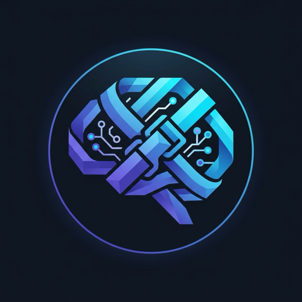
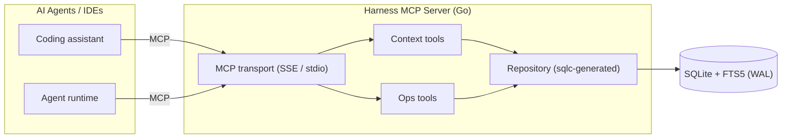
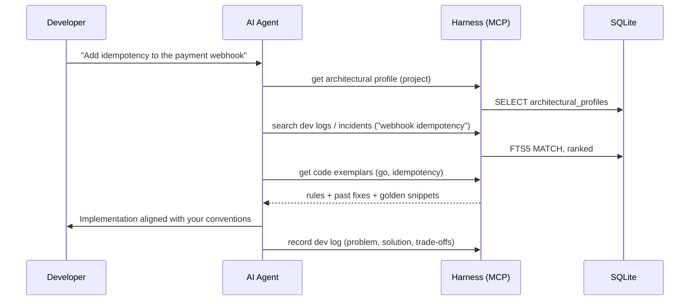
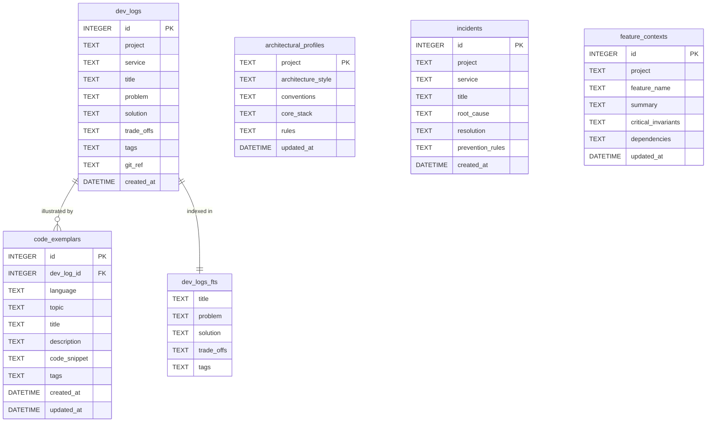

<div align="center">



# Harness

**Give your AI coding agents your engineering experience.**

A lightweight, local-first [Model Context Protocol (MCP)](https://modelcontextprotocol.io/) server, written in Go, that turns your past architectural decisions, solved production bugs, and hard-earned engineering instincts into a persistent context layer for AI agents.

[](https://github.com/Ayobami6/harness/actions/workflows/ci.yml)
[](https://github.com/Ayobami6/harness/actions/workflows/codeql.yml)
[](https://go.dev/)
[](LICENSE)
[](https://modelcontextprotocol.io/)
[](https://www.sqlite.org/fts5.html)
[](#project-status)

[Why Harness](#why-harness) •
[How It Works](#how-it-works) •
[Quick Start](#quick-start) •
[Configuration](#configuration) •
[Agent Setup](#using-harness-with-ai-agents) •
[Data Model](#data-model) •
[Development](#development) •
[Roadmap](#roadmap) •
[Contributing](#contributing)

</div>

---

> **What if you had an agent that thinks like you, codes like you, and does things the way you would?**

Most AI coding assistants start from zero on every prompt. Harness gives them your track record: the problems you've solved, the trade-offs you've accepted, the incidents you've survived, and the code patterns you trust. Your agent then writes software the way you build it.

## Table of Contents

- [Why Harness](#why-harness)
- [Features](#features)
- [How It Works](#how-it-works)
- [Project Status](#project-status)
- [Quick Start](#quick-start)
  - [Prerequisites](#prerequisites)
  - [Run Locally](#run-locally)
  - [Run with Docker Compose](#run-with-docker-compose)
- [Configuration](#configuration)
- [Using Harness with AI Agents](#using-harness-with-ai-agents)
  - [Install the Binary](#install-the-binary)
  - [Transports](#transports)
  - [Run Harness as an HTTP Server](#run-harness-as-an-http-server)
  - [Claude Code](#claude-code)
  - [Claude Desktop](#claude-desktop)
  - [Antigravity](#antigravity)
  - [Gemini CLI](#gemini-cli)
  - [Cursor](#cursor)
  - [VS Code (GitHub Copilot)](#vs-code-github-copilot)
  - [Windsurf](#windsurf)
  - [OpenAI Codex CLI](#openai-codex-cli)
  - [Quick Reference](#quick-reference)
  - [Running Harness in Docker for stdio Clients](#running-harness-in-docker-for-stdio-clients)
  - [Teach Your Agent to Use Harness](#teach-your-agent-to-use-harness)
- [Data Model](#data-model)
- [Project Structure](#project-structure)
- [Development](#development)
  - [Make Targets](#make-targets)
  - [Database Migrations](#database-migrations)
  - [Code Generation with sqlc](#code-generation-with-sqlc)
  - [Testing and Linting](#testing-and-linting)
  - [CI & Automated Code Reviews](#ci--automated-code-reviews)
- [Roadmap](#roadmap)
- [Contributing](#contributing)
- [License](#license)

---

## Why Harness

AI coding assistants don't know your history:

- **They don't know your past fixes.** The race condition you solved in your ledger service six months ago is invisible to them.
- **They don't know your rules.** Your team may avoid certain ORMs or require idempotency keys on payment webhooks. The agent has no way to know that.
- **They fall back to generic boilerplate.** The default output often breaks production constraints you've already learned the hard way.

Harness fills this gap by acting as both a memory layer and a set of operational tools for your agents.

## Features

| Capability | Description |
|---|---|
| 🧠 **Developer memory** | Records and indexes the problems you tackle, the solutions you deploy, and the trade-offs you accept, across all your projects. |
| 🏛️ **Architecture and style alignment** | Stores per-project architecture styles, conventions, core stacks, and strict DO/DON'T rules so the agent follows them. |
| 🔥 **Incident recall** | Keeps post-mortems (root cause, resolution, prevention rules) so the agent doesn't repeat past failures. |
| 🧩 **Feature backstory** | Tracks critical invariants and dependencies for each feature, so changes respect constraints that can't be broken. |
| ✨ **Golden code exemplars** | Saves canonical, approved snippets by language and topic (e.g. `db_transaction`, `worker_pool`) as reference implementations. |
| 🔎 **Full-text search** | Ranked SQLite FTS5 search across your dev logs, kept in sync automatically by triggers. |
| 🪶 **Local-first, zero friction** | A single static Go binary (pure-Go SQLite driver, no CGO) and an embedded database. Runs in seconds via Docker Compose or natively. |

## How It Works



1. **Capture.** You (or your agent) record dev logs, incidents, architectural profiles, feature contexts, and code exemplars.
2. **Index.** Harness stores them in SQLite. Dev logs are indexed with FTS5 for fast, ranked retrieval.
3. **Inject.** When an agent works on a task, it calls Harness over MCP to pull in the relevant history, rules, and exemplars before it writes code.

## Project Status

> [!IMPORTANT]
> Harness is in **early development**. APIs, schema, and tool names may change without notice before `v1.0.0`.

| Component | Status |
|---|---|
| Configuration loading (env / `.env`) and structured logging (`log/slog`) | ✅ Implemented |
| SQLite connection (WAL, foreign keys, busy timeout) | ✅ Implemented |
| Initial schema and Goose migrations | ✅ Implemented |
| sqlc query definitions (dev logs, incidents, profiles, features, exemplars) | ✅ Implemented |
| Docker / Docker Compose packaging | ✅ Implemented |
| sqlc-generated repository layer (`internal/repository`) | ✅ Implemented  |
| MCP server and transports (`internal/mcp`) | ✅ Implemented  |
| Context and ops tools (`internal/tools`) | ✅ Implemented |
| `/healthz` endpoint and graceful shutdown (SIGTERM) | ✅ Implemented |

## Quick Start

### Prerequisites

- [Go](https://go.dev/dl/) **1.26+**
- [Goose](https://github.com/pressly/goose) for migrations (`make goose-install`)
- [sqlc](https://docs.sqlc.dev/en/latest/overview/install.html) *(only needed to regenerate the data access layer)*
- [golangci-lint](https://golangci-lint.run/welcome/install/) *(only needed for development)*
- [Docker](https://docs.docker.com/get-docker/) with Compose v2 *(optional)*

### Run Locally

```sh
git clone https://github.com/Ayobami6/harness.git
cd harness

# Install the pinned Goose CLI (make sure $(go env GOPATH)/bin is on your PATH)
make goose-install

# Apply migrations to ./harness.db, then start Harness
make up
```

`make up` runs `make migrate-up` and then `make run` (`go run cmd/main.go`).

To build a standalone binary:

```sh
CGO_ENABLED=0 go build -ldflags="-s -w" -o bin/harness ./cmd/main.go
./bin/harness
```

### Run with Docker Compose

```sh
# Apply migrations to the persistent volume
make docker-migrate-up

# Build and start the stack
make docker-up

# Tear it down
make docker-down
```

The container exposes port **9090** and stores the database at `/data/harness.db` on the named volume `harness_storage`.

> [!NOTE]
> The image is a multi-stage build on `alpine`. It includes the `harness` binary, the `goose` CLI, and the migration files, so you can run migrations inside the container without installing anything on the host.

## Configuration

Harness reads its configuration from environment variables. If a `.env` file exists in the working directory, it is loaded first. A missing `.env` file is ignored.

Each setting accepts a namespaced `HARNESS_*` variable, which takes precedence, or a short fallback name. Empty or whitespace-only values are treated as unset.

| Variable | Fallback | Default | Description |
|---|---|---|---|
| `HARNESS_DB_PATH` | `DB_PATH` | `./harness.db` | Path to the SQLite database file. |
| `HARNESS_LOG_LEVEL` | `LOG_LEVEL` | `info` | One of `debug`, `info`, `warn`/`warning`, `error`, or any value `slog.Level` accepts (e.g. `INFO+2`). |
| `HARNESS_PORT` | `PORT` | `9090` | Port the server listens on. |
| `HARNESS_TRANSPORT` | `TRANSPORT` | `sse` | MCP transport mode. Planned values are `stdio` and `http` (Streamable HTTP). See [Transports](#transports). |

Example `.env`:

```dotenv
HARNESS_DB_PATH=./harness.db
HARNESS_LOG_LEVEL=debug
HARNESS_PORT=9090
HARNESS_TRANSPORT=sse
```

### SQLite Tuning

Every connection is opened with:

- `journal_mode(WAL)`: readers and the writer don't block each other.
- `foreign_keys(1)`: referential integrity is enforced.
- `busy_timeout(5000)`: waits up to 5s on a lock instead of failing immediately.
- A single open connection (`SetMaxOpenConns(1)`), which avoids `SQLITE_BUSY` contention between writers.

## Using Harness with AI Agents

Harness works with any MCP-compatible client. You can connect a client in one of two ways:

- **Local process (stdio):** the client starts the `harness` binary itself and talks to it over stdin/stdout. This is the recommended setup for local-first use, and every major client supports it.
- **Network service (HTTP):** you run Harness once (for example with `make docker-up`), and one or more clients connect to `http://localhost:9090`. Use this when several agents or machines share the same memory.

> [!WARNING]
> The MCP server layer is still [in development](#project-status). The configurations below show the **intended** setup. The endpoint path (`/mcp`) and the transport values may change before `v1.0.0`.

### Install the Binary

```sh
git clone https://github.com/Ayobami6/harness.git
cd harness
mkdir -p ~/.local/bin ~/.harness
CGO_ENABLED=0 go build -ldflags="-s -w" -o ~/.local/bin/harness ./cmd/main.go

# Create the database once
make migrate-up DB_PATH=$HOME/.harness/harness.db
```

Make sure `~/.local/bin` is on your `PATH`. The examples below use `/Users/you/.harness/harness.db` as the database path. MCP clients don't expand `~`, so **use absolute paths** in their config files.

> [!TIP]
> Point every client at the **same** database file. Then a bug fix you record from Claude Code is available to Antigravity, Cursor, or any other agent you use.

### Transports

| Transport | `HARNESS_TRANSPORT` | Endpoint | Best for |
|---|---|---|---|
| stdio | `stdio` | stdin/stdout | A single developer, with the client managing the process |
| Streamable HTTP | `http` | `http://localhost:9090/mcp` | A shared or long-running server (Docker), multiple clients |

> [!NOTE]
> Harness uses the modern MCP **Streamable HTTP** transport, not the legacy HTTP+SSE transport. Some clients, including Antigravity, don't support the legacy one at all. If a client can only start local processes, use [`mcp-remote`](https://www.npmjs.com/package/mcp-remote) to bridge stdio to HTTP. The [Claude Desktop](#claude-desktop) section shows an example.

### Run Harness as an HTTP Server

Every HTTP configuration below expects Harness to be running already and listening on port `9090`.

Natively:

```sh
HARNESS_TRANSPORT=http \
HARNESS_PORT=9090 \
HARNESS_DB_PATH=$HOME/.harness/harness.db \
harness
```

With Docker Compose, set `HARNESS_TRANSPORT=http` in [`docker-compose.yml`](docker-compose.yml) and run:

```sh
make docker-migrate-up
make docker-up
```

> [!CAUTION]
> The HTTP endpoint has **no authentication** yet. Bind it to `localhost`, or keep it on a trusted private network. Don't expose port `9090` to the public internet.

### Claude Code

**stdio**, using the CLI:

```sh
claude mcp add harness \
  --scope user \
  --env HARNESS_TRANSPORT=stdio \
  --env HARNESS_DB_PATH=$HOME/.harness/harness.db \
  -- harness
```

**Streamable HTTP**, using the CLI:

```sh
claude mcp add --transport http --scope user harness http://localhost:9090/mcp
```

To share the setup with your team, commit a project-scoped `.mcp.json` at the repository root.

**stdio** (`.mcp.json`):

```json
{
  "mcpServers": {
    "harness": {
      "command": "harness",
      "env": {
        "HARNESS_TRANSPORT": "stdio",
        "HARNESS_DB_PATH": "/Users/you/.harness/harness.db"
      }
    }
  }
}
```

**Streamable HTTP** (`.mcp.json`):

```json
{
  "mcpServers": {
    "harness": {
      "type": "http",
      "url": "http://localhost:9090/mcp"
    }
  }
}
```

Check the connection with `claude mcp list`, or run `/mcp` inside a session.

### Claude Desktop

Edit `claude_desktop_config.json`. You can open it from **Settings → Developer → Edit Config**.

- macOS: `~/Library/Application Support/Claude/claude_desktop_config.json`
- Windows: `%APPDATA%\Claude\claude_desktop_config.json`

**stdio**:

```json
{
  "mcpServers": {
    "harness": {
      "command": "/Users/you/.local/bin/harness",
      "env": {
        "HARNESS_TRANSPORT": "stdio",
        "HARNESS_DB_PATH": "/Users/you/.harness/harness.db"
      }
    }
  }
}
```

**Streamable HTTP**: Claude Desktop's config file can only start local processes, so use `mcp-remote` to connect to the running server. This requires Node.js.

```json
{
  "mcpServers": {
    "harness": {
      "command": "npx",
      "args": ["-y", "mcp-remote", "http://localhost:9090/mcp"]
    }
  }
}
```

> [!NOTE]
> Claude's **Settings → Connectors** (custom connectors) connect from Anthropic's cloud, so they can't reach `localhost`. Use a connector only if Harness is deployed behind a public HTTPS URL with authentication.

Restart Claude Desktop afterwards. The Harness tools will appear in the tools (🔨) menu.

### Antigravity

Add Harness to `~/.gemini/config/mcp_config.json`. You can also open it from **Additional Options (…) → MCP Servers**.

**stdio**:

```json
{
  "mcpServers": {
    "harness": {
      "command": "/Users/you/.local/bin/harness",
      "env": {
        "HARNESS_TRANSPORT": "stdio",
        "HARNESS_DB_PATH": "/Users/you/.harness/harness.db"
      }
    }
  }
}
```

**Streamable HTTP**:

```json
{
  "mcpServers": {
    "harness": {
      "url": "http://localhost:9090/mcp"
    }
  }
}
```

Once connected, Antigravity adds the Harness tools to the agent's toolset automatically. You can check them under **MCP Servers** in the UI.

### Gemini CLI

Add to `~/.gemini/settings.json` (global) or `.gemini/settings.json` (per project).

**stdio**:

```json
{
  "mcpServers": {
    "harness": {
      "command": "harness",
      "env": {
        "HARNESS_TRANSPORT": "stdio",
        "HARNESS_DB_PATH": "/Users/you/.harness/harness.db"
      }
    }
  }
}
```

**Streamable HTTP**. Use `httpUrl`; Gemini CLI uses the `url` key for legacy SSE servers.

```json
{
  "mcpServers": {
    "harness": {
      "httpUrl": "http://localhost:9090/mcp"
    }
  }
}
```

Or use the CLI: `gemini mcp add --transport http harness http://localhost:9090/mcp`. Run `/mcp` in a session to check the connection.

### Cursor

Add to `~/.cursor/mcp.json` (global) or `.cursor/mcp.json` (per project).

**stdio**:

```json
{
  "mcpServers": {
    "harness": {
      "command": "harness",
      "env": {
        "HARNESS_TRANSPORT": "stdio",
        "HARNESS_DB_PATH": "/Users/you/.harness/harness.db"
      }
    }
  }
}
```

**Streamable HTTP**:

```json
{
  "mcpServers": {
    "harness": {
      "url": "http://localhost:9090/mcp"
    }
  }
}
```

Check that the server is green under **Settings → MCP**.

### VS Code (GitHub Copilot)

Add to `.vscode/mcp.json` in your workspace. VS Code uses a top-level `servers` key.

**stdio**:

```json
{
  "servers": {
    "harness": {
      "type": "stdio",
      "command": "harness",
      "env": {
        "HARNESS_TRANSPORT": "stdio",
        "HARNESS_DB_PATH": "/Users/you/.harness/harness.db"
      }
    }
  }
}
```

**Streamable HTTP**:

```json
{
  "servers": {
    "harness": {
      "type": "http",
      "url": "http://localhost:9090/mcp"
    }
  }
}
```

Then open Copilot Chat in **Agent** mode and turn on the Harness tools.

### Windsurf

Add to `~/.codeium/windsurf/mcp_config.json`.

**stdio**:

```json
{
  "mcpServers": {
    "harness": {
      "command": "/Users/you/.local/bin/harness",
      "env": {
        "HARNESS_TRANSPORT": "stdio",
        "HARNESS_DB_PATH": "/Users/you/.harness/harness.db"
      }
    }
  }
}
```

**Streamable HTTP**:

```json
{
  "mcpServers": {
    "harness": {
      "serverUrl": "http://localhost:9090/mcp"
    }
  }
}
```

### OpenAI Codex CLI

Add to `~/.codex/config.toml`.

**stdio**:

```toml
[mcp_servers.harness]
command = "harness"
env = { HARNESS_TRANSPORT = "stdio", HARNESS_DB_PATH = "/Users/you/.harness/harness.db" }
```

**Streamable HTTP**:

```toml
[mcp_servers.harness]
url = "http://localhost:9090/mcp"
```

> [!NOTE]
> Older Codex releases need `experimental_use_rmcp_client = true` at the top level of `config.toml` before they support HTTP servers. On those versions, you can use the `mcp-remote` bridge instead: `command = "npx"`, `args = ["-y", "mcp-remote", "http://localhost:9090/mcp"]`.

### Quick Reference

| Client | Config file | stdio keys | Streamable HTTP keys |
|---|---|---|---|
| Claude Code | `.mcp.json` / `claude mcp add` | `command`, `env` | `"type": "http"`, `url` |
| Claude Desktop | `claude_desktop_config.json` | `command`, `env` | via `mcp-remote` bridge |
| Antigravity | `~/.gemini/config/mcp_config.json` | `command`, `env` | `url` |
| Gemini CLI | `~/.gemini/settings.json` | `command`, `env` | `httpUrl` |
| Cursor | `~/.cursor/mcp.json` | `command`, `env` | `url` |
| VS Code | `.vscode/mcp.json` (`servers`) | `"type": "stdio"`, `command` | `"type": "http"`, `url` |
| Windsurf | `~/.codeium/windsurf/mcp_config.json` | `command`, `env` | `serverUrl` |
| Codex CLI | `~/.codex/config.toml` | `command`, `env` | `url` |

### Running Harness in Docker for stdio Clients

If you'd rather not install Go, any stdio client can start Harness from the container image instead:

```json
{
  "mcpServers": {
    "harness": {
      "command": "docker",
      "args": [
        "run", "-i", "--rm",
        "-v", "harness_storage:/data",
        "-e", "HARNESS_TRANSPORT=stdio",
        "harness-harness"
      ]
    }
  }
}
```

`harness-harness` is the image name Docker Compose builds by default. Run `docker images` to check it.

### Teach Your Agent to Use Harness

Connecting the server makes the tools available. Adding a short rule to your agent's instructions file makes sure the agent actually uses them. Put the rule in `CLAUDE.md` (Claude Code), `GEMINI.md` (Antigravity / Gemini CLI), `AGENTS.md` (Codex and others), `.cursor/rules/` (Cursor), or `.github/copilot-instructions.md` (Copilot).

```markdown
## Harness Memory Protocol

Before you plan or write code:
1. Load this project's architectural profile from Harness and follow its rules strictly.
2. Search Harness dev logs and incidents for the area you're changing. Don't repeat known failures.
3. Load the feature context for the component you're touching, and respect its critical invariants.
4. Prefer Harness code exemplars for the language and topic over generic patterns.

After you finish a non-trivial change:
5. Record a dev log in Harness: problem, solution, trade-offs, tags, and the git ref.
6. If the change fixed a production bug, also record an incident with prevention rules.
```



> [!NOTE]
> Tool names will be listed here when the [context tools](#roadmap) ship. Until then, the protocol above is written to describe what each step does rather than which tool it calls.

## Data Model

The schema lives in [`db/migrations`](db/migrations), and the typed queries live in [`db/queries`](db/queries).



| Table | Purpose | Notable queries |
|---|---|---|
| `dev_logs` | Your daily development stream: problem, solution, trade-offs, and git ref. | CRUD, list by project/service, counts, `SearchDevLogsFTS`, `SearchDevLogsFTSByProject` |
| `dev_logs_fts` | FTS5 external-content index over `dev_logs`, kept in sync by insert, update, and delete triggers. | Ranked `MATCH` search |
| `architectural_profiles` | One profile per project: architecture style, plus JSON arrays of conventions, core stack, and strict rules. | `UpsertArchitecturalProfile`, `GetArchitecturalProfileByProject` |
| `incidents` | Post-mortems: root cause, resolution, and prevention rules. | CRUD, list by project/service, `CountIncidentsByProject` |
| `feature_contexts` | Per-feature backstory with critical invariants and dependencies (JSON). Unique on `(project, feature_name)`. | `UpsertFeatureContext`, `GetFeatureContextByProjectAndName` |
| `code_exemplars` | Golden snippets by `language` and `topic`, optionally linked to the dev log they came from (`ON DELETE SET NULL`). | List by language, topic, or dev log |

## Project Structure

```text
harness/
├── cmd/
│   └── main.go                 # Entrypoint: config → logger → DB connection
├── config/
│   ├── config.go               # Env/.env configuration loading
│   └── logger.go               # slog logger factory
├── db/
│   ├── db.go                   # SQLite connection (modernc.org/sqlite, pure Go)
│   ├── migrations/             # Goose SQL migrations (also the sqlc schema source)
│   └── queries/                # sqlc query definitions
├── internal/
│   ├── mcp/                    # MCP server & transports (planned)
│   ├── repository/             # sqlc-generated data access layer
│   └── tools/
│       ├── context/            # Context-retrieval MCP tools (planned)
│       └── ops/                # Operational MCP tools (planned)
├── Dockerfile                  # Multi-stage build (golang:alpine → alpine)
├── docker-compose.yml
├── Makefile
├── sqlc.yml
└── .golangci.yml
```

## Development

### Make Targets

| Target | Description |
|---|---|
| `make run` | Run Harness with `go run`. |
| `make up` | Apply migrations, then run. |
| `make test` | Run all tests with the race detector (`go test -race -v ./...`). |
| `make test-cov` | Run tests with an atomic coverage profile and print a per-function summary. |
| `make test-cov-html` | Generate `coverage.html`. |
| `make lint` | Run `golangci-lint`. |
| `make build` | Build a static binary into `bin/harness` (`CGO_ENABLED=0`). |
| `make ci` | Run `lint`, `test`, and `build` sequentially. |
| `make generate` / `make sqlc-generate` | Regenerate the repository layer with sqlc. |
| `make goose-install` | Install the pinned Goose CLI (`v3.29.0`, SQLite-only build tags). |
| `make migrate-create name=<name>` | Create a new SQL migration. |
| `make migrate-status` / `migrate-up` / `migrate-down` | Manage local migrations. |
| `make docker-up` / `docker-down` | Start or stop the Compose stack (aliases: `compose-up` / `compose-down`). |
| `make docker-migrate-status` / `docker-migrate-up` / `docker-migrate-down` | Manage migrations inside the container. |

### Database Migrations

Schema changes are managed with [Goose](https://github.com/pressly/goose) SQL migrations in `db/migrations`.

```sh
# Create a migration
make migrate-create name=create_example_table
```

Edit the generated file. Put the forward change in the `-- +goose Up` section and its reversal in the `-- +goose Down` section. Multi-statement blocks, such as triggers, must be wrapped in `-- +goose StatementBegin` / `-- +goose StatementEnd`.

```sh
make migrate-status
make migrate-up
make migrate-down
```

Commands target `./harness.db` by default. You can override this:

```sh
make migrate-up DB_PATH=/path/to/harness.db
```

### Code Generation with sqlc

[sqlc](https://sqlc.dev/) reads the **same** `db/migrations` directory as its schema source (see [`sqlc.yml`](sqlc.yml)) and generates type-safe Go code from `db/queries` into `internal/repository`. The generated code includes a `Querier` interface and JSON tags.

```sh
make generate
```

> [!TIP]
> Goose applies the schema to the database, and sqlc generates Go code from the same SQL. Because both read the same files, the migrations remain the single source of truth.

### Testing and Linting

```sh
make test       # race-enabled unit tests
make test-cov   # coverage summary
make lint       # golangci-lint
```

The linter configuration ([`.golangci.yml`](.golangci.yml)) enables `gosec`, `errorlint`, `noctx`, `sqlclosecheck`, `bodyclose`, `revive`, `misspell`, and `unconvert`, and formats code with `gofmt`.

Before opening a pull request, both of these must pass:

```sh
golangci-lint run
go test -race ./...
```

### CI & Automated Code Reviews

Every push to `main` and pull request runs three GitHub Actions workflows in [`.github/workflows/`](.github/workflows):

| Workflow | File | Checks |
|---|---|---|
| **CI** | [`ci.yml`](.github/workflows/ci.yml) | `go mod tidy` check, `golangci-lint`, race-enabled unit tests on Linux & macOS with coverage summary, Goose migration lifecycle (`up` → `down` → `up`), `sqlc compile` + `sqlc generate` drift verification, cross-platform static binary builds (`linux/darwin/windows`, `amd64/arm64`), Docker Buildx image build + container migration smoke test, and `govulncheck`. |
| **Code Review & PR Quality** | [`code-review.yml`](.github/workflows/code-review.yml) | Enforces Conventional Commit PR titles, runs GitHub Dependency Review (blocking high-severity CVEs and copyleft licenses), posts inline PR review annotations from `golangci-lint` via **reviewdog**, and (when `GEMINI_API_KEY` is configured in repository secrets) posts an automated **Gemini AI architectural & code review** on the PR diff. |
| **CodeQL Security Analysis** | [`codeql.yml`](.github/workflows/codeql.yml) | Runs GitHub CodeQL `security-extended` and `security-and-quality` static analysis for Go on pushes, PRs, and a weekly schedule. |

Dependabot ([`.github/dependabot.yml`](.github/dependabot.yml)) opens weekly update PRs for Go modules, GitHub Actions, and the Dockerfile.

## Roadmap

- [x] Configuration, logging, and SQLite bootstrap
- [x] Initial schema with FTS5-indexed dev logs
- [x] sqlc query definitions for all domains
- [x] Generated repository layer and unit tests
- [x] MCP server with stdio and Streamable HTTP transports
- [x] Context tools: search dev logs, fetch architectural profile, recall incidents, fetch feature context, fetch code exemplars
- [ ] Ops tools: schema inspection, test running, failure diagnostics
- [x] `/healthz` endpoint and graceful shutdown (SIGTERM)
- [x] Client configuration guides (Claude Code, Claude Desktop, Antigravity, Gemini CLI, Cursor, VS Code, Windsurf, Codex)
- [] One-command installer (`go install` / Homebrew)
- [ ] Pre-built release binaries and container images

## Contributing

Contributions are welcome. Harness follows a few conventions:

1. **Branch from `main`** using `<type>/<short-description>` (e.g. `feat/mcp-sse-transport`, `fix/fts-trigger`).
2. **Use [Conventional Commits](https://www.conventionalcommits.org/)**: `<type>(<scope>): <description>`.
3. **Keep the architecture clean.** Domain logic must have no I/O. Adapters go behind interfaces (ports). Pass `context.Context` as the first argument to all I/O. Wrap errors with context (`fmt.Errorf("...: %w", err)`).
4. **Change schema only through migrations.** Never edit an applied migration. Add a new one and run `make generate`.
5. **Pass the quality gates**: `make lint` and `make test`.
6. **Open a PR** that includes a summary of the changes, any architectural decisions or trade-offs, and verification evidence (commands run and their output). Link the related issue (`Closes #123`).

Found a bug or have an idea? [Open an issue](https://github.com/Ayobami6/harness/issues).

## License

Harness is released under the [MIT License](LICENSE). © 2026 Ayobami Alaran.
